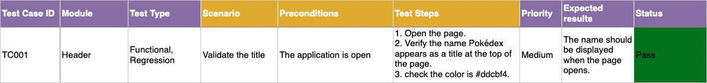

# Poke-project
Pokedex App | Challenge

## Pokedex App

A web application that simulates a **Pokedex** using realtime data from the Pokemon API.

## Description

>This app helps you explore different Pokémon species; you can view information about each Pokémon and save them to your favorites.
>
>>
* Search for Pokemon by name.
* List of Pokemon with pagination.
* Displays Pokemon details.
* Save Pokemon to favorites and remove them from favorites.
* Favorite Pokemon stored in localStorage
* Exception handling in search.
>>

### Stack

* HTML5
* CSS3
* JavaScript (ES6)
* Bootstrap
* API REST (PokéAPI)

### How to run the project

1. Clone the repository
2. Open the `index.html file`
3. Or use Live Server in VS Code.

## Test Matrix

>The quality control test matrix contains the manual of test cases designed to validate the Pokédex application.
>

## Links
[Download the complete matrix](./docs/pokedex_Test_Matrix.xlsx)

## Images
